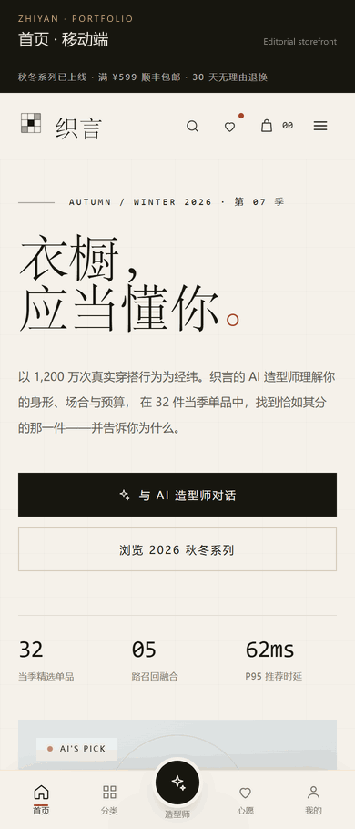

# ZHIYAN · 电商智能体与推荐系统

> 面向服装零售的电商平台与 AI 造型师 Agent。项目覆盖商品浏览、会员、交易、推荐、对话式导购、Agent 发布管理与离线 ML，强调可解释、可评测、可降级、可回滚。

织言 ZHIYAN 是一套完整的服装电商工程实现。用户端提供移动优先的商城、会员中心与 AI 造型师；管理端提供 Agent 草稿、上架/下架、不可变版本、回滚与调用 Key；Agent 服务负责意图理解、五路召回、融合排序、RAG 理由、11 个工具调用、护栏与 SSE 流式输出。推荐链路与 Agent Registry 共享商品、画像、库存、订单与行为数据。

  

## 系统组成

| 子系统 | 目录 | 核心职责 | 主要技术 |
| --- | --- | --- | --- |
| 用户端 | `电商智能推荐/src/app/(store)`、`src/components/storefront` | 商城、筛选与搜索、购物袋、结算、会员中心、AI 造型师 | Next.js 16 App Router、React 19 RSC、Tailwind CSS 4、SSE |
| 管理端 | `电商智能推荐/src/app/admin`、`src/components/admin` | Agent 草稿、上架/下架、版本、回滚、调用 Key | HMAC HttpOnly Cookie、Bearer、Client 表单、审计 |
| Agent 服务 | `电商智能推荐/src/lib/agent`、`src/lib/agents`、`src/app/api/agent*` | 意图、工具编排、护栏、SSE、Registry 与运行时契约 | Tool Calling、RAG、Zod、能力发现、Prometheus |
| 推荐与画像 | `电商智能推荐/src/lib/engine` | 五路召回、融合排序、MMR、理由生成、画像更新 | Embedding、Item-CF/User-CF、规则、趋势、编辑精选 |
| 数据与交易 | `电商智能推荐/src/lib/store`、`src/lib/commerce` | 商品、会员、订单、购物袋、库存承诺、幂等 | JSON 原子写、PostgreSQL JSONB、服务端会话 |
| 离线 ML | `电商智能推荐/ml` | Spark 特征、双塔召回、LightGBM 排序、离线评估 | PySpark、PyTorch、LightGBM |

## 核心能力

- **可解释推荐**：意图理解 → 五路召回 → 10 因子融合 → MMR 多样性 → RAG 理由，每条推荐带证据、来源与置信度。
- **对话式导购**：自然语言理解场景、预算、尺码与偏好，支持整套搭配、尺码建议、商品对比、政策检索、购物袋与订单查询。
- **Agent 控制面**：草稿与已发布快照分离，版本不可变；下架即阻断调用，回滚生成新版本，调用 Key 只存哈希。
- **交易一致性**：下单幂等键、库存承诺、取消/退货释放、Ops 履约与退款接口。
- **可观测性**：能力发现 `/api/agent/capabilities`、健康检查 `checks.agent` / `checks.llm`、Agent P95/护栏/意图指标、离线评测门禁。
- **可降级运行**：无模型 Key、模型超时或事实校验失败时回退本地规划器；外部 LLM 只参与理解与润色，价格、库存、政策与尺码事实由商品库、RAG 与护栏兜底。

## 技术栈

| 层 | 技术 |
| --- | --- |
| 前端 | Next.js 16 App Router、React 19 Server Components、TypeScript strict、Tailwind CSS 4 |
| 会员与权限 | 微信 OAuth 2.0（HMAC state）、手机号验证码、服务端会话 Cookie、按 `userId` 隔离 |
| Agent | 意图/槽位、工具白名单、LLM/规则双规划器、11 个工具、护栏、SSE、会话记忆、全链路 trace |
| 检索与排序 | 256 维确定性哈希嵌入、Item-CF/User-CF、规则召回、趋势召回、编辑精选、10 因子排序、MMR |
| 理由生成 | 画像、商品特征、评价、搭配规则、趋势证据组合；可选 LLM 改写并做事实复核 |
| 数据 | 原子写 JSON 文件或 PostgreSQL JSONB；购物袋、订单、画像、Agent 日志、Registry |
| 离线 ML | PySpark 特征工程、PyTorch 双塔、LightGBM 排序、Precision/Recall/NDCG/Coverage/Novelty 评估 |
| 工程与运维 | Docker、Compose、Nginx（SSE 不缓冲）、健康检查、Prometheus、Vitest、Playwright、CI |

## 工程与验证

- **78** 个 Vitest 单元/集成测试，覆盖意图、召回、排序、搭配、定价、库存、会员登录、Agent 评测、Registry 与护栏。
- **14** 项 Playwright 端到端冒烟（配置 `AGENT_ADMIN_TOKEN` 时），覆盖下单、取消、会员登录、移动端个人中心、Agent 契约与生命周期。
- Agent 评测基线：意图 33/33、槽位 13/13、检索 Top-1 10/10、注入拦截 15/15、正常问题误伤 0/10。
- 健康检查区分 `checks.agent` 与 `checks.llm`；指标提供 Agent P95、护栏命中、意图分布与反馈。
- 内置 A/B 与离线评估产物只用于工程验证，不代表真实商业结果。

## 文档导航

| 内容 | 文档 |
| --- | --- |
| 完整项目说明 | [电商智能推荐/README.md](电商智能推荐/README.md) |
| 项目与架构概览 | [PROJECT-OVERVIEW.md](电商智能推荐/PROJECT-OVERVIEW.md) |
| 用户端技术栈 | [docs/user-app.md](电商智能推荐/docs/user-app.md) |
| 管理端技术栈 | [docs/admin-app.md](电商智能推荐/docs/admin-app.md) |
| Agent 平台与生命周期 | [docs/agent-platform.md](电商智能推荐/docs/agent-platform.md) |
| Agent 服务契约 | [docs/agent-service-contract.md](电商智能推荐/docs/agent-service-contract.md) |
| Agent 评测基线 | [docs/agent-evaluation.md](电商智能推荐/docs/agent-evaluation.md) |
| 部署与运行 | [docs/deployment.md](电商智能推荐/docs/deployment.md) |
| 公开部署拓扑 | [docs/public-deployment.md](电商智能推荐/docs/public-deployment.md) |
| 上线差距清单 | [docs/production-readiness-gap.md](电商智能推荐/docs/production-readiness-gap.md) |

## 数据说明

仓库内商品、会员、订单、评价与指标均为合成数据，用于功能与工程验证；支付、真实微信授权、短信、物流与发票需要外部平台账号与资质。
