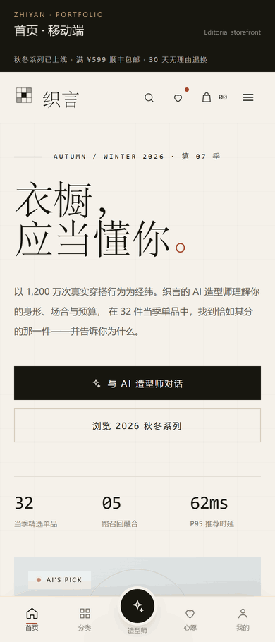
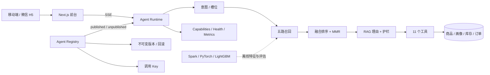
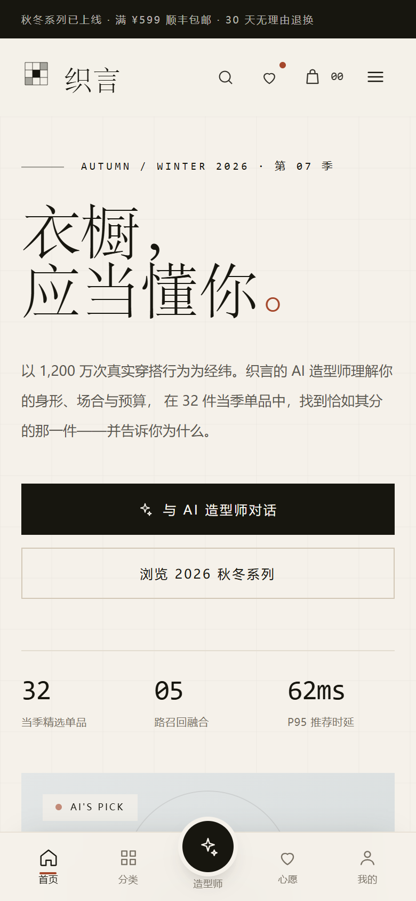
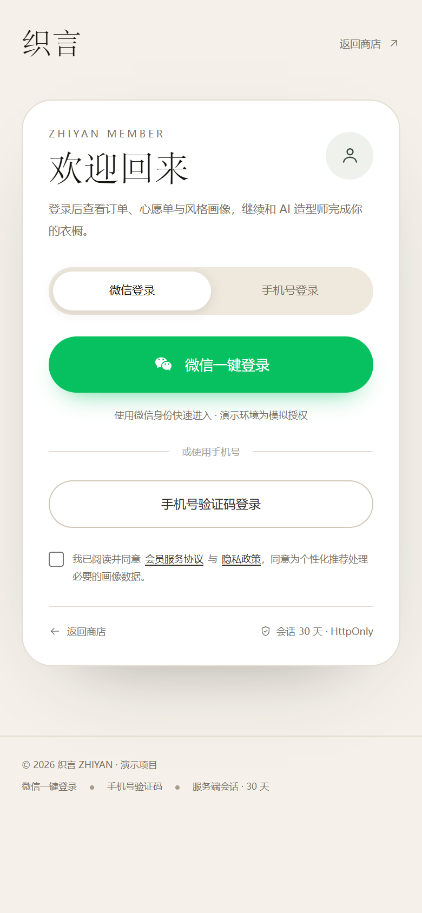
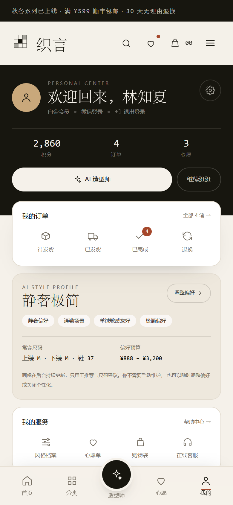
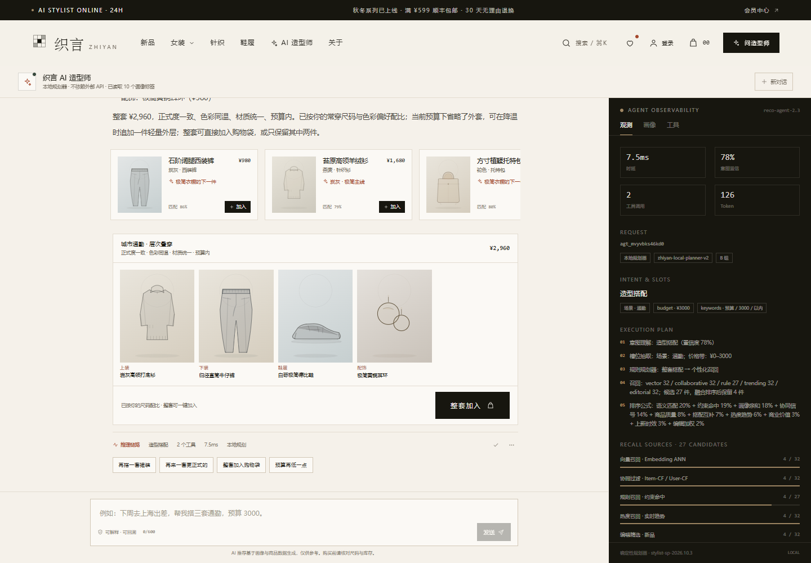
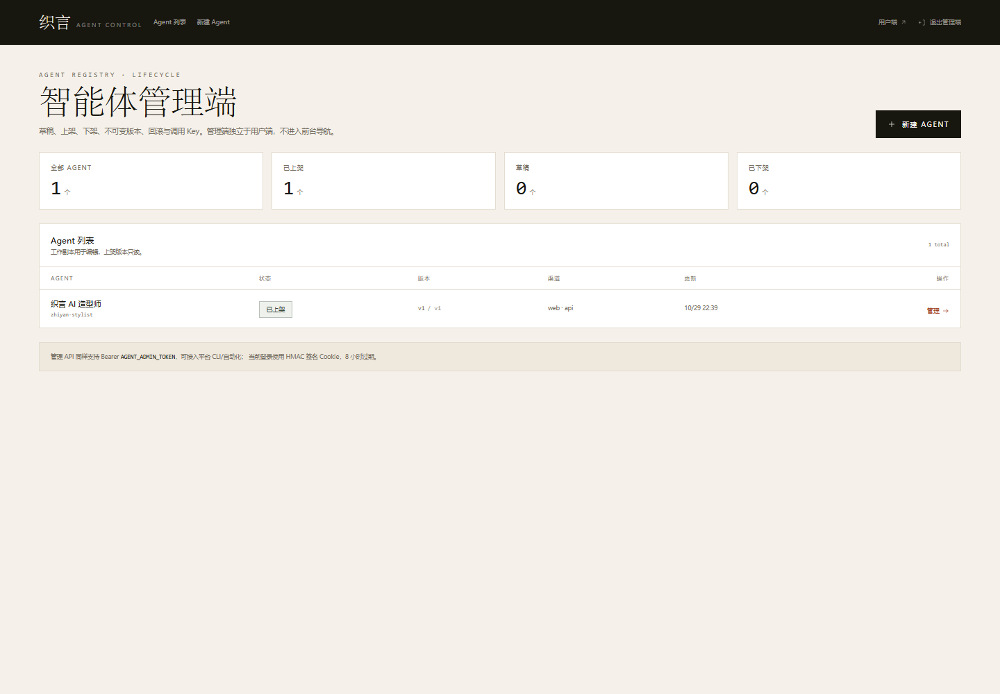
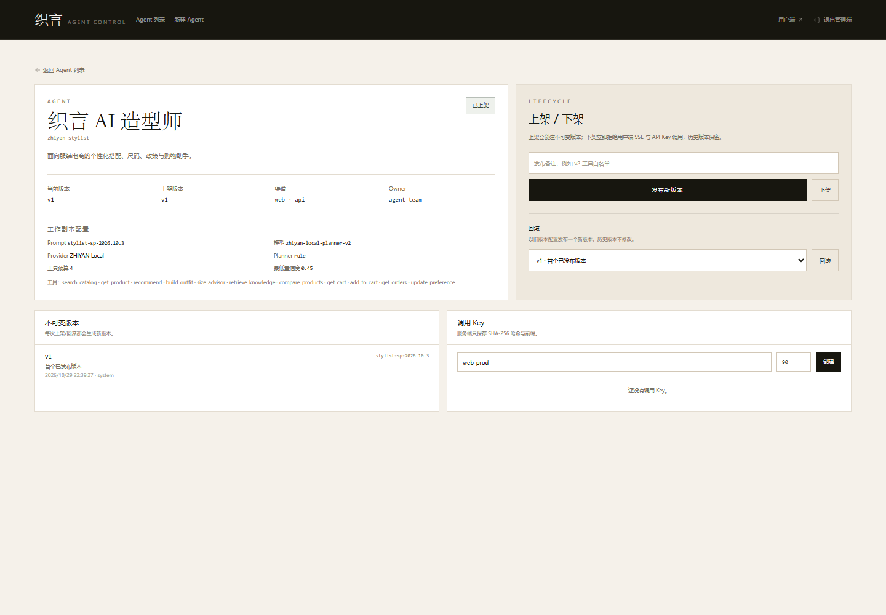

# ZHIYAN · 服装电商 AI 造型师与推荐系统

> **项目定位：面向服装零售的 AI Agent 与推荐系统**
> 把服装导购从“搜索框”变成可解释、可评测、可上架/下架的智能体服务，同时保留完整的电商交易链路。

## 1. 项目背景

服装电商的用户问题通常不是“找不到商品”，而是：

- 不知道什么场合穿什么；
- 有预算但不会组合整套；
- 尺码、面料、退换政策需要反复询问；
- 推荐结果缺乏理由，用户不信任；
- 运营希望快速上线/下线一个 Agent，而不是每次改代码、重启、赌效果。

系统把这些问题拆成 **推荐引擎 + Agent 工具编排 + RAG/护栏 + Agent 生命周期控制面**，并与商品、画像、库存、购物袋、订单等业务数据联动。

## 2. 系统组成

| 子系统 | 目录 | 职责 |
| --- | --- | --- |
| 用户端 | `src/app/(store)`、`src/components/storefront`、`src/components/product`、`src/components/stylist` | 商城、筛选与搜索、商品详情、购物袋、结算、会员中心、AI 造型师 |
| 管理端 | `src/app/admin`、`src/components/admin`、`src/app/api/agents` | Agent 草稿、上架/下架、不可变版本、回滚、调用 Key、审计 |
| Agent 运行时 | `src/lib/agent` | 意图/槽位、工具规划、护栏、SSE、会话记忆、全链路追踪 |
| 推荐引擎 | `src/lib/engine` | 五路召回、融合排序、MMR、RAG 理由、画像与特征 |
| 交易与数据 | `src/lib/store`、`src/lib/commerce` | 商品、会员、订单、购物袋、库存承诺、幂等与原子写 |
| 离线 ML | `ml/` | Spark 特征工程、PyTorch 双塔、LightGBM 排序、离线评估与模型卡 |
| 平台契约 | `src/app/api/agent/capabilities`、`src/app/api/health`、`src/app/api/metrics` | 能力发现、健康检查、Prometheus 指标与评测门禁 |

## 3. 总体架构

**Agent 决策链**：意图理解 → 多路召回 → 排序 → 推荐理由生成 → 工具执行 → 护栏 → SSE。

**交易链路**：浏览/搜索 → 购物袋 → 库存校验 → 幂等下单 → 测试支付 → 取消/退货 → Ops 履约与退款。推荐与 Agent 读取同一份商品、画像、库存与订单事实。

## 4. 核心能力

| 能力 | 实现 |
| --- | --- |
| 多路召回 | 向量、Item-CF/User-CF、规则、趋势、编辑精选；不是“只做 RAG” |
| 可解释推荐 | 每条理由带 `evidence[]`、置信度与来源 |
| Agent 工具 | 11 个工具，写入型工具必须用户明确指令；白名单 + 工具预算 |
| 护栏 | 注入拦截、PII 掩码、价格/库存事实校验、政策引用、尺码免责 |
| 评测 | 33 意图、13 槽位、10 检索、15 注入、正常问题误伤 0 |
| 降级 | 无 Key / 模型超时 / 事实校验失败自动回退本地规划器 |
| Agent Registry | 草稿 → 上架 → 下架；不可变版本、回滚、调用 Key、审计 |
| 管理端 UI | 独立控制面；Token 登录、Agent 列表、创建、发布、回滚、Key 管理 |
| 运行时门禁 | 下架后 Web SSE 返回 503，API 调用返回 409 |
| 用户隔离 | 每个会员独立 `userId`，订单/购物袋/心愿单/画像不串号 |
| 交易一致性 | 结算幂等键、库存承诺、取消/退货释放、OMS 履约/退款接口 |

## 5. 技术栈

| 层 | 技术 |
| --- | --- |
| 前端 | Next.js 16 App Router、React 19 Server Components、TypeScript strict、Tailwind CSS 4 |
| 用户交互 | React client islands、Context（Cart / Wishlist / Toast）、SSE、移动优先布局 |
| 会员 | 微信 OAuth 2.0、HMAC state、手机号验证码、服务端会话 Cookie、SHA-256 会话哈希 |
| Agent | 意图/槽位、规则规划器与 LLM 规划器、工具注册、RAG、护栏、SSE、会话记忆 |
| 推荐 | 256 维确定性哈希嵌入、Item-CF/User-CF、规则召回、趋势召回、编辑精选、10 因子排序、MMR |
| 画像 | 静态偏好、行为序列、RFM、品类/色彩/风格亲和度、实时增量更新 |
| 数据 | 原子写 JSON 文件、PostgreSQL JSONB、单实例互斥、幂等键 |
| 离线 ML | PySpark、PyTorch 双塔、LightGBM、Precision/Recall/NDCG/Coverage/Novelty |
| 工程 | Vitest、Playwright、TypeScript strict、Docker、Compose、Nginx、Prometheus、Zod |

### 5.1 用户端

用户端以移动优先的方式组织商品浏览、会员中心与造型师对话：首页展示个性化推荐与 Lookbook，列表页提供颜色/尺码/场景/风格/价格筛选，详情页把尺码建议、RAG 理由与整套搭配放在同一决策路径中。购物袋与结算复用服务端库存校验与幂等下单；个人中心把画像收在后台，只展示用户可理解的风格摘要、尺码、订单与心愿单。

会员登录同时支持微信 OAuth 与手机号验证码。微信回调使用 HMAC 签名 state 防 CSRF；服务端会话只保存随机令牌并按 SHA-256 哈希校验，30 天可撤销。每位会员拥有独立 `userId`，订单、购物袋、心愿单、画像与 Agent 上下文均按会员隔离。

### 5.2 管理端

管理端是 Agent 控制面，不承担商品/订单后台。它管理 Agent 草稿与已发布快照：上架时把工作副本写入不可变版本；下架立即阻断用户端 SSE 与管理 API 调用；回滚读取历史版本并发布为新版本，不修改历史。调用 Key 使用 `zya_` 前缀，明文只在创建时返回一次，服务端只存 SHA-256，可撤销、可过期。

认证使用 `AGENT_ADMIN_TOKEN` 换取 HMAC 签名的 `zy_admin` HttpOnly Cookie（8 小时），管理 API 同时接受 Bearer Token；未配置 Token 时管理接口返回 503。管理端整体 `noindex`，不进入用户端导航。

### 5.3 Agent 服务

Agent 单轮流程为：输入清洗与 PII 掩码 → 意图/槽位理解并合并最近上下文 → 规划工具 → 执行并记录参数/耗时/产物 → 组合回答 → 护栏校验 → SSE 输出 → 持久化消息、槽位与日志。

工具覆盖商品检索、商品详情、推荐、整套搭配、尺码建议、RAG 知识检索、商品对比、购物袋读取、加购、订单查询与偏好更新。写入型工具只在用户明确表达指令时执行，并受每轮工具预算限制。未配置模型 Key、模型超时或事实校验失败时，运行时回退本地确定性规划器，保证对话与导购能力可用。

### 5.4 推荐与画像

推荐链路使用五路召回：向量召回负责语义相似与冷启动，协同过滤提供群体行为信号，规则召回处理品类/颜色/尺码/预算/场景硬约束，热度召回覆盖新客与兜底，编辑精选承载品牌叙事。硬约束导致候选过少时，优先放宽颜色，再上浮价格上限，不放宽库存与品类，并在 trace 中标注。

融合排序使用语义、协同、约束、亲和度、趋势、质量、搭配、商业、新鲜度、编辑十个因子，按首页/造型师/详情页/购物袋/搜索/结算/邮件场景加权，再用 MMR 与品类配额控制多样性。RAG 理由从画像、商品特征、评价、搭配规则与趋势证据生成，返回 `headline + detail + evidence[] + confidence`，前台展示，Agent trace 可追溯。

### 5.5 数据与交易

默认存储为原子写入的本地 JSON，单文件覆盖商品、会员、订单、购物袋、画像、Agent 日志与 Registry；可选 PostgreSQL 单表 JSONB，启动时自动建表。结算使用订单承诺库存、幂等键与单实例互斥；取消/退货释放库存；Ops API 提供发货、完成与退款状态流转。

### 5.6 离线 ML

`ml/spark` 生成行为与商品特征，`ml/train/two_tower.py` 训练双塔召回，`ml/train/rank_lgbm.py` 训练排序模型，`ml/eval/offline_eval.py` 输出 Precision/Recall/NDCG/Coverage/Novelty。在线服务当前使用确定性哈希嵌入作为零依赖回退；接入双塔向量时保持 `EMBEDDING_DIM`、归一化与在线索引一致。

## 6. 关键流程

### 6.1 推荐请求

前台请求 `/api/reco` → 读取会员画像与场景 → 意图/硬约束 → 五路召回 → 融合排序 → MMR → 生成带证据的理由与 trace → 返回商品卡。浏览、加购、收藏与对话事件写入行为序列，分钟级进入画像与排序特征。

### 6.2 对话请求

`POST /api/agent/chat` 建立 SSE → `meta` 返回模式/模型/Prompt 版本 → `stage` 输出理解与工具阶段 → `trace` 记录召回、工具、护栏与时延 → `products/outfit` 返回商品卡与整套搭配 → `delta` 流式文本 → `done` 结束。下架默认 Agent 后，SSE 返回 503；能力发现仍可用于平台探针。

### 6.3 Agent 发布与回滚

创建草稿 → 保存工作副本 → 上架生成不可变版本 v1 → 运行时读取已发布快照 → 修改配置后再次上架生成 v2 → 回滚 v1 时生成 v3（内容等同 v1）→ 下架阻断调用。Key 与 Agent 绑定，撤销后立即 401，已发出的请求不受影响。

## 7. 工程质量与评测

- **78** 个 Vitest 单元/集成测试通过。
- **14** 项 Playwright E2E（配置 `AGENT_ADMIN_TOKEN` 时）通过。
- Agent 专项 **61** 项通过。
- 评测基线：意图 33/33、槽位 13/13、检索 Top-1 10/10、注入 15/15、正常问题误伤 0/10。
- 实测生命周期：创建草稿 → 上架 v1 → Key 调用 → 下架 409 → 再上架 v2 → 回滚 v1 生成 v3 → 撤销 Key 401。
- 健康检查 `/api/health` 区分 `checks.agent` / `checks.llm`；指标 `/api/metrics` 提供 Agent P95、护栏命中、意图分布与反馈。

> 内置 A/B 与离线评估中的 +40% / +60% / +80% / +70% 用于验证实验与指标链路，不代表真实业务增长。

## 8. 系统边界与外部依赖

仓库覆盖用户端、管理端、Agent 运行时、推荐引擎、交易与离线 ML，并提供 Docker、健康检查、指标与评测契约。

真实上线仍依赖外部系统与资质：微信开放平台与短信供应商、支付/退款商户号、PIM/ERP/库存中心、OMS/物流/发票、ICP 与生成式 AI 合规、集群与密钥托管。生产接入清单见 [`docs/production-readiness-gap.md`](docs/production-readiness-gap.md)。

## 9. 当前实现与生产接入差距

| 能力 | 当前实现 | 生产接入 |
| --- | --- | --- |
| 微信/短信 | 测试授权与固定验证码，可切真实 OAuth | 开放平台 AppID/Secret、回调域、短信签名模板 |
| 支付/退款 | 测试支付 + 退款状态/OMS 接口 | 商户号、回调验签、对账、真实退款 |
| 商品/库存 | 32 个合成 SKU | PIM/ERP/库存中心 |
| 订单履约 | 种子订单 + Ops API | OMS/物流、退货入库、发票 |
| 数据层 | 文件 / 单表 JSONB | 拆表、事务/行锁、Redis、备份演练 |
| 合规 | 隐私页与测试环境 | 备案、隐私评审、生成式 AI 合规 |

## 10. 界面

| 移动端首页 | 会员登录 |
| --- | --- |
|  |  |

| 个人中心 | AI 造型师 |
| --- | --- |
|  |  |

| Agent 管理端 | 上架 / 下架 / Key |
| --- | --- |
|  |  |

## 11. 文档索引

- [完整项目说明](README.md) — 推荐引擎、Agent、商城、数据、ML、质量与部署
- [用户端技术栈](docs/user-app.md) — 页面、登录、会话、Agent 体验
- [管理端技术栈](docs/admin-app.md) — 认证、生命周期、安全边界
- [Agent 平台](docs/agent-platform.md) — Registry、上架/下架、版本、Key、CLI
- [Agent 服务契约](docs/agent-service-contract.md) — API、SSE、能力发现、SLO
- [评测基线](docs/agent-evaluation.md) — 意图/槽位/RAG/注入评测
- [上线差距](docs/production-readiness-gap.md) — P0/P1/P2 清单
- [部署](docs/deployment.md) — Docker / Compose / Nginx / Postgres / TLS
